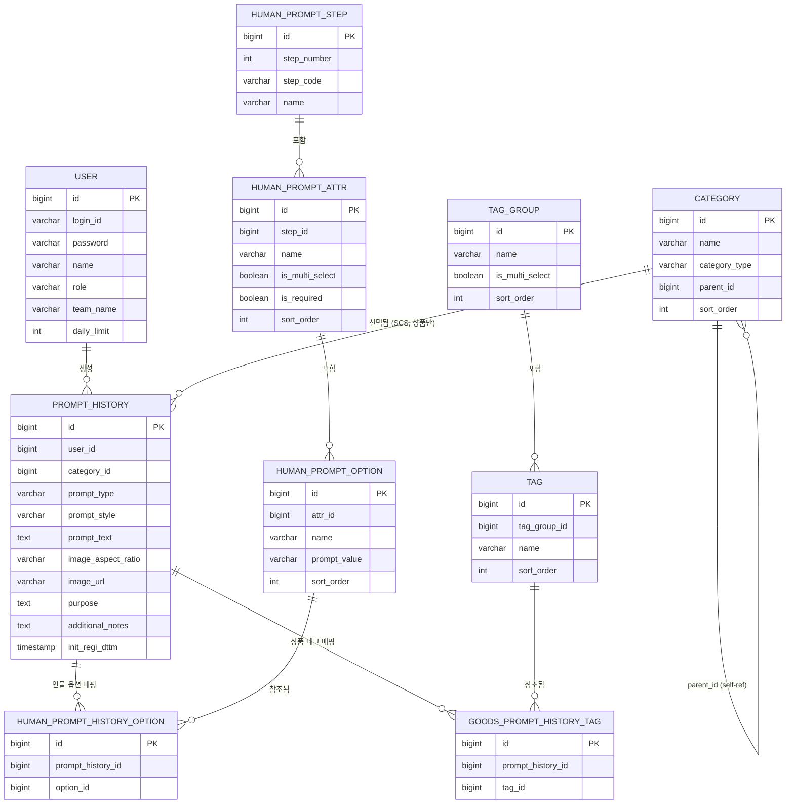

# ERD 및 테이블 정의

> **최초 작성일**: 2026-02-26
> **기반 문서**: `docs/requirements.md`

---

## DB 설계 원칙 요약

- **PK**: 모든 테이블 `BIGINT GENERATED ALWAYS AS IDENTITY`
- **FK 제약조건**: DB에 생성하지 않음. 논리적 관계만 ERD로 관리, 참조 무결성은 Service에서 보장
- **공통 감사(Audit) 컬럼**: 모든 테이블에 아래 4개 컬럼 포함

| DB 컬럼명 (snake_case) | Java 필드명 (camelCase) | 설명 |
|---|---|---|
| `init_regi_pic` | `initRegiPic` | 등록자 (`login_id` 저장) |
| `init_regi_dttm` | `initRegiDttm` | 등록일시 |
| `final_rvis_pic` | `finalRvisPic` | 최종수정자 (`login_id` 저장) |
| `final_rvis_dttm` | `finalRvisDttm` | 최종수정일시 |

---

## 테이블 목록

| 테이블명 | Java 엔티티 | 설명 |
|---|---|---|
| `user` | `User` | 회원 정보, 권한, 팀명, 일일 생성 한도 |
| `category` | `Category` | 상품 카테고리 (3단계 계층: LCS→MCS→SCS) |
| `tag_group` | `TagGroup` | 태그 묶음 (인물, 분위기 등) |
| `tag` | `Tag` | 태그 값 (남자, 화사한 등) |
| `prompt_history` | `PromptHistory` | 생성된 프롬프트 저장 (상품/인물 공통) |
| `goods_prompt_history_tag` | `GoodsPromptHistoryTag` | 상품 프롬프트-태그 다대다 매핑 (상품 전용) |
| `human_prompt_history_option` | `HumanPromptHistoryOption` | 인물 프롬프트-선택옵션 매핑 (인물 전용) |

---

## 테이블 상세 정의

### `user`

회원 정보. ADMIN이 직접 계정 생성 (자가 회원가입 없음).

| 컬럼명 | 타입 | 제약 | 설명 |
|---|---|---|---|
| `id` | BIGINT | PK, GENERATED ALWAYS AS IDENTITY | 회원 고유 ID |
| `login_id` | VARCHAR | NOT NULL, UNIQUE | 로그인 아이디 |
| `password` | VARCHAR | NOT NULL | 암호화된 비밀번호 |
| `name` | VARCHAR | NOT NULL | 회원 이름 |
| `role` | VARCHAR | NOT NULL | 권한 (`ADMIN` / `MANAGER` / `USER`) |
| `team_name` | VARCHAR | | 팀명 (논리적 팀 구분, 별도 Team 테이블 없음) |
| `daily_limit` | INT | NOT NULL | 하루 프롬프트 생성 허용 횟수 |
| `init_regi_pic` | VARCHAR | | 등록자 |
| `init_regi_dttm` | TIMESTAMP | | 등록일시 |
| `final_rvis_pic` | VARCHAR | | 최종수정자 |
| `final_rvis_dttm` | TIMESTAMP | | 최종수정일시 |

---

### `category`

상품 카테고리. 3단계 계층을 self-reference 구조로 관리.

| 컬럼명 | 타입 | 제약 | 설명 |
|---|---|---|---|
| `id` | BIGINT | PK, GENERATED ALWAYS AS IDENTITY | 카테고리 고유 ID |
| `name` | VARCHAR | NOT NULL | 카테고리명 |
| `category_type` | VARCHAR | NOT NULL | 계층 구분 (`LCS` / `MCS` / `SCS`) |
| `parent_id` | BIGINT | nullable | 상위 카테고리 ID (LCS는 NULL) |
| `sort_order` | INT | | 정렬 순서 |
| `init_regi_pic` | VARCHAR | | 등록자 |
| `init_regi_dttm` | TIMESTAMP | | 등록일시 |
| `final_rvis_pic` | VARCHAR | | 최종수정자 |
| `final_rvis_dttm` | TIMESTAMP | | 최종수정일시 |

**계층 구조 예시**
```
LCS: 식품 (parent_id = NULL)
  MCS: 건강식품 (parent_id = LCS.id)
    SCS: 인삼 (parent_id = MCS.id)  ← 프롬프트 생성 시 최종 선택값
```

---

### `tag_group`

태그 묶음. 그룹별로 단일/복수 선택 여부를 관리.

| 컬럼명 | 타입 | 제약 | 설명 |
|---|---|---|---|
| `id` | BIGINT | PK, GENERATED ALWAYS AS IDENTITY | 태그 그룹 고유 ID |
| `name` | VARCHAR | NOT NULL | 그룹명 (예: 인물, 분위기) |
| `is_multi_select` | BOOLEAN | NOT NULL | 복수 선택 허용 여부 |
| `sort_order` | INT | | 정렬 순서 |
| `init_regi_pic` | VARCHAR | | 등록자 |
| `init_regi_dttm` | TIMESTAMP | | 등록일시 |
| `final_rvis_pic` | VARCHAR | | 최종수정자 |
| `final_rvis_dttm` | TIMESTAMP | | 최종수정일시 |

---

### `tag`

태그 값. 태그 그룹에 속하는 개별 선택지.

| 컬럼명 | 타입 | 제약 | 설명 |
|---|---|---|---|
| `id` | BIGINT | PK, GENERATED ALWAYS AS IDENTITY | 태그 고유 ID |
| `tag_group_id` | BIGINT | NOT NULL | 소속 태그 그룹 ID (논리 FK → `tag_group.id`) |
| `name` | VARCHAR | NOT NULL | 태그명 (예: 남자, 여자, 화사한) |
| `sort_order` | INT | | 정렬 순서 |
| `init_regi_pic` | VARCHAR | | 등록자 |
| `init_regi_dttm` | TIMESTAMP | | 등록일시 |
| `final_rvis_pic` | VARCHAR | | 최종수정자 |
| `final_rvis_dttm` | TIMESTAMP | | 최종수정일시 |

---

### `prompt_history`

생성된 프롬프트 저장. 상품/인물 프롬프트 공통 테이블. `prompt_type`으로 구분.

| 컬럼명 | 타입 | 제약 | 설명 |
|---|---|---|---|
| `id` | BIGINT | PK, GENERATED ALWAYS AS IDENTITY | 프롬프트 히스토리 고유 ID |
| `user_id` | BIGINT | NOT NULL | 생성자 ID (논리 FK → `user.id`) |
| `category_id` | BIGINT | nullable | 선택한 상품 SCS 카테고리 ID (논리 FK → `category.id`), 인물은 NULL |
| `prompt_type` | VARCHAR(10) | NOT NULL DEFAULT 'PRODUCT' | `'PRODUCT'` / `'PERSON'` |
| `prompt_style` | VARCHAR(20) | NOT NULL | `'NANO_BANANA'` / `'MID_JOURNEY'` (기본값은 Service에서 적용) |
| `prompt_text` | TEXT | NOT NULL | Gemini가 생성한 영문 프롬프트 |
| `image_url` | VARCHAR(500) | nullable | NanoBanana 이미지 생성 URL (DB에는 상대 경로 저장, 응답 시 `image.base-url` prefix를 붙여 절대 URL 조립) |
| `image_aspect_ratio` | VARCHAR(10) | nullable | 이미지 생성 비율 (예: `1:1`, `4:3`, `16:9`, `9:16`). 상품·인물 공통. 미입력 시 Gemini가 기본 비율 사용 |
| `purpose` | TEXT | nullable | 인물 프롬프트 생성 목적 (상품은 NULL) |
| `additional_notes` | TEXT | nullable | 인물 프롬프트 추가 지시사항 (상품은 NULL) |
| `init_regi_pic` | VARCHAR | | 등록자 |
| `init_regi_dttm` | TIMESTAMP | | 등록일시 (일일 사용량 집계 기준) |
| `final_rvis_pic` | VARCHAR | | 최종수정자 |
| `final_rvis_dttm` | TIMESTAMP | | 최종수정일시 |

> `init_regi_dttm` 기준으로 범위 조건(`>= CURRENT_DATE AND < CURRENT_DATE + 1day`)의 COUNT로 일일 사용량을 체크한다. `(user_id, init_regi_dttm)` 복합 인덱스(`idx_prompt_history_user_date`) 활용.

---

### `goods_prompt_history_tag`

상품 프롬프트와 태그의 다대다 매핑 테이블. **상품 프롬프트 전용.**

| 컬럼명 | 타입 | 제약 | 설명 |
|---|---|---|---|
| `id` | BIGINT | PK, GENERATED ALWAYS AS IDENTITY | 매핑 고유 ID |
| `prompt_history_id` | BIGINT | NOT NULL | 프롬프트 ID (논리 FK → `prompt_history.id`) |
| `tag_id` | BIGINT | NOT NULL | 태그 ID (논리 FK → `tag.id`) |
| `init_regi_pic` | VARCHAR | | 등록자 |
| `init_regi_dttm` | TIMESTAMP | | 등록일시 |
| `final_rvis_pic` | VARCHAR | | 최종수정자 |
| `final_rvis_dttm` | TIMESTAMP | | 최종수정일시 |

---

### `human_prompt_history_option`

인물 프롬프트 생성 시 사용자가 선택한 옵션 매핑 테이블. **인물 프롬프트 전용.**

| 컬럼명 | 타입 | 제약 | 설명 |
|---|---|---|---|
| `id` | BIGINT | PK, GENERATED ALWAYS AS IDENTITY | 매핑 고유 ID |
| `prompt_history_id` | BIGINT | NOT NULL | 프롬프트 ID (논리 FK → `prompt_history.id`) |
| `option_id` | BIGINT | NOT NULL | 선택한 옵션 ID (논리 FK → `human_prompt_option.id`) |
| `init_regi_pic` | VARCHAR | | 등록자 |
| `init_regi_dttm` | TIMESTAMP | | 등록일시 |
| `final_rvis_pic` | VARCHAR | | 최종수정자 |
| `final_rvis_dttm` | TIMESTAMP | | 최종수정일시 |

---

## ERD (논리 관계도)

> DB에 FK CONSTRAINT는 생성하지 않음. 아래는 논리적 참조 관계.


